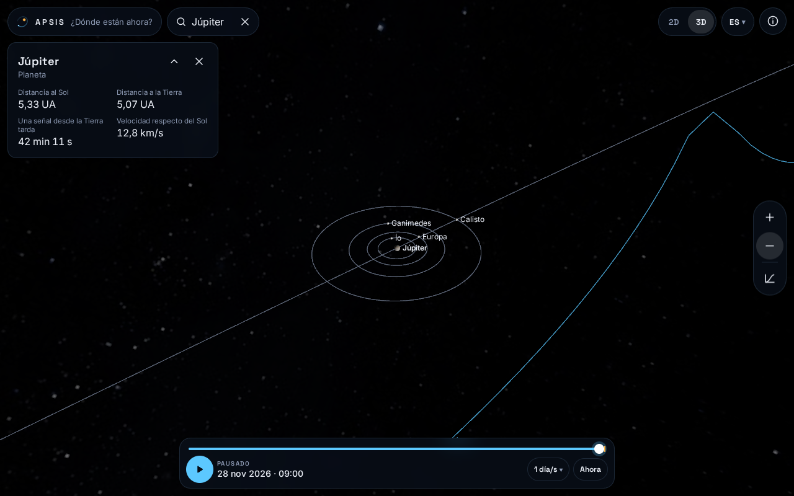
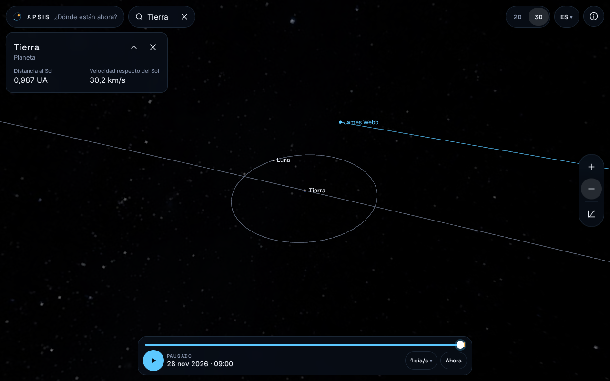

# Close-ups

Select a planet and the 3D camera flies to it (see [selection.md](selection.md)); from
step 7.2 its moons are there too, on their orbits, at their positions for the shown
instant. The data behind them is ADR 0015.

| Jupiter and the Galilean moons  | Saturn and Titan              | Earth and the Moon          |
| ------------------------------- | ----------------------------- | --------------------------- |
|  |  |  |

## Where a moon is

A moon has no heliocentric positions in the data, only a **track**: its orbital
elements around its planet, one sample a day, from Horizons (`ELEMENTS` with the planet's
centre as the origin). `core/elements.ts` carries the moon along each day's ellipse to
the instant (Kepler's equation) and blends the two days either side; `core/positions.ts`
adds that to the planet's own position:

```ts
positionAt('io', t, world); // Jupiter's heliocentric position + Io's offset from its track
```

Against Horizons' own positions, six-hourly over two days: exact at each sample, within
325 km of Io's 422,000 km orbit in between (`elements.test.ts`). Anything with a track
uses it wherever the track covers the instant, so orbiters (Juno, step 7.4) can join the
same way.

## In the 3D view

Moons are `SceneBody`s with a `parent` and a `localOrbit`:

- **placed** by `place(t)` (`positionAt`), like every other body now;
- **drawn** at least 4 px across (planets 7, the Sun 12), at true size close up;
- **turned** so the same face looks at their planet, as tidally locked moons do;
- **orbits** from the day's elements (`sampleOrbit`), around the planet's position,
  through the moon (`orbitPathThrough`, as for planets);
- **hidden** with their orbits while they're within 8 px of their planet's disc on
  screen (`#hideCrowdedMoons`): from across the solar system they'd only crowd it.

The 2D map and the AR tabletop leave moons out: at their scale a moon sits on its
planet.

## The card

A moon's card reads "Luna de Júpiter", with its distances and speed; its velocity comes
from two positions a minute apart (`velocityAt`). Any position from a track carries a
note: "Posición calculada a partir de elementos orbitales diarios de JPL Horizons".

## The moons

The Moon; Io, Europa, Ganymede and Callisto; Enceladus and Titan. Archived from 1977, so
Voyager's flybys show the moons it saw.

Their maps (and the small bodies', for step 7.3) are in `public/textures/bodies/`, with
their sources in `CREDITS.md`: the Moon from Solar System Scope, the rest from USGS
mosaics of Voyager, Galileo, Cassini, Dawn and New Horizons images, public domain.
Unimaged areas are filled with the surface's average colour; Titan's is its
near-infrared surface map tinted to its haze, not its true colour. They're never
precached: the service worker keeps each one once a close-up has shown it.
