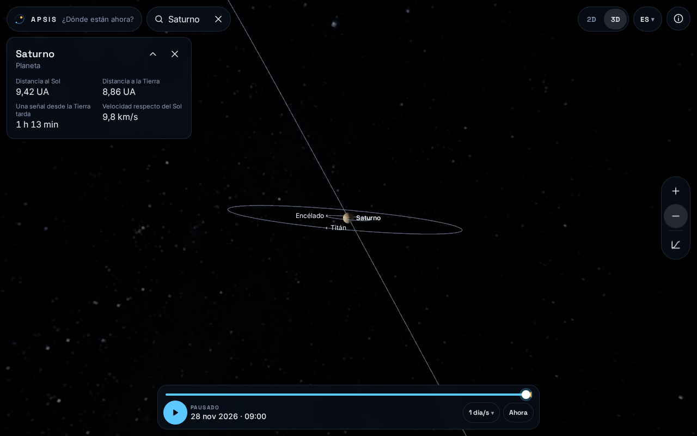

# Close-ups

Select a planet and the 3D camera flies to it (see [selection.md](selection.md)); from
step 7.2 its moons are there too, on their orbits, at their positions for the shown
instant. The data behind them is ADR 0015.

| Jupiter and the Galilean moons  | Saturn and Titan              | Earth and the Moon          |
| ------------------------------- | ----------------------------- | --------------------------- |
|  |  |  |

## Where a moon is

A moon has no heliocentric positions in the data, only a **track**: its orbital
elements around its planet, one sample a day, from Horizons (`ELEMENTS` with the planet's
centre as the origin). `core/elements.ts` carries the moon along each day's ellipse to
the instant (Kepler's equation) and blends the two days either side; `core/positions.ts`
adds that to the planet's own position:

```ts
positionAt('io', t, world); // Jupiter's heliocentric position + Io's offset from its track
```

Against Horizons' own positions, six-hourly over two days: exact at each sample, within
325 km of Io's 422,000 km orbit in between (`elements.test.ts`). Anything with a track
uses it wherever the track covers the instant, so orbiters (Juno, step 7.4) can join the
same way.

## In the 3D view

Moons are `SceneBody`s with a `parent` and a `localOrbit`:

- **placed** by `place(t)` (`positionAt`), like every other body now;
- **drawn** at least 4 px across (planets 7, the Sun 12), at true size close up;
- **turned** so the same face looks at their planet, as tidally locked moons do;
- **orbits** from the day's elements (`sampleOrbit`), around the planet's position,
  through the moon (`orbitPathThrough`, as for planets);
- **hidden** with their orbits while they're within 8 px of their planet's disc on
  screen (`#hideCrowdedMoons`): from across the solar system they'd only crowd it.

The 2D map and the AR tabletop leave moons out: at their scale a moon sits on its
planet.

## The card

A moon's card reads "Luna de Júpiter", with its distances and speed; its velocity comes
from two positions a minute apart (`velocityAt`). Any position from a track carries a
note: "Posición calculada a partir de elementos orbitales diarios de JPL Horizons".

## Orbiters

While a spacecraft circles a planet it has a track there too (7.4): Juno around
Jupiter from 2016, Cassini around Saturn 2004–2017, Galileo around Jupiter 1995–2003,
BepiColombo around Mercury from 21 November 2026. The catalogue says when
(`orbiting: { body, from, to? }`, the day after orbit insertion, when the orbit is
closed), and the fetch keeps only closed-orbit samples.

At periapsis an orbiter moves fastest: daily elements put Juno 6,000 km off near
Jupiter's cloud tops, where it passes 4,000 km up. So each daily sample predicts the next
periapsis (`periapsisTimes`: `t + (360° − M)/n`) and the fetch adds hourly elements for
12 hours either side (`PERIAPSIS_HOURS`), merged in like an encounter's hourly states.
Measured across a perijove against Horizons, hourly: a median of 2 km, at most 540 km
(just outside the hourly window, when Juno is already 100,000 km out).

In 3D, while the track covers the instant, the spacecraft draws its current orbit around
the planet in its own colour, and its 30-day heliocentric trail (a jagged polygon of
daily points around a planet) steps aside. Its card carries the "calculada" note.

Around Mars (7.5): Mars Reconnaissance Orbiter, MAVEN (until it fell silent on 6 December
2025), Mars Express, ExoMars TGO, Mars Odyssey and Hope, each from the day after its
orbit insertion. Their two-hour orbits get no hourly periapsis samples (only orbits
longer than two days do): a dozen extra requests a day for each, while their daily
elements are already close. Tianwen-1 is left out: Horizons has only its cruise.

Dawn (Vesta, Ceres) and Rosetta (67P) are deferred: Horizons gives no orbital elements
around small bodies ("required masses not defined").

## Small bodies

Where missions went: the dwarf planets Pluto and Ceres, the asteroids Vesta, Psyche and
Didymos, comet 67P/Churyumov–Gerasimenko and the Kuiper belt object Arrokoth (7.3). Each
has a track around the Sun (`center: 'sun'`) sampled every 10 days, enough for their
slow ellipses; 67P's Horizons ID is `DES=1000012;CAP;`, the orbit solution of its closest
apparition. Moons and small bodies have only a track: the scripts fetch no heliocentric
states for them (`TRACK_ONLY`).

They're drawn at least 5 px across, with their orbits around the Sun (fainter on the
map), Pluto, Ceres and Vesta with their maps, the rest in a plain rock colour: spheres
for now, real shapes later. The picker lists them in a group of their own, and each
card says what it is ("Planeta enano", "Cometa"…).

## The moons

The Moon; Io, Europa, Ganymede and Callisto; Enceladus and Titan; Phobos and Deimos;
Triton; Charon, around Pluto. Archived from 1977, so
Voyager's flybys show the moons it saw.

Their maps (and the small bodies', for step 7.3) are in `public/textures/bodies/`, with
their sources in `CREDITS.md`: the Moon from Solar System Scope, the rest from USGS
mosaics of Voyager, Galileo, Cassini, Dawn and New Horizons images, public domain.
Unimaged areas are filled with the surface's average colour; Titan's is its
near-infrared surface map tinted to its haze, not its true colour. They're never
precached: the service worker keeps each one once a close-up has shown it.

## Around Earth

The ISS, Hubble and Tiangong (7.6, ADR 0016) come from CelesTrak, not Horizons: the
catalogue gives `celestrak: 25544` (the satellite's catalogue number) and `horizons: null`.
`npm run data` fetches each one's latest orbital elements (`scripts/data/celestrak.ts`,
validated by `parseGp`) and puts them in `index.json`; `positionAt` carries them to the
instant (`core/earth-orbit.ts`: an ellipse that Earth's bulge turns, rotated into the
ecliptic) and adds Earth's position, within three days of the data (`SATELLITE_DAYS`).

The card gives the height above Earth, the speed relative to Earth and the time a turn
takes, with the note "Órbita aproximada, calculada con datos de CelesTrak del…". Picked
in 3D, a satellite is framed with Earth (`framedByParent`), with its ellipse around it
(`elementsFromState`, from its position and velocity). The map and the tabletop leave
satellites out.
