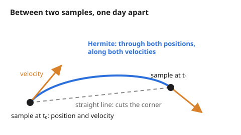

# Time and interpolation

How the app turns "now" (or any instant) into a position for each body. Code:
`src/core/time.ts`, `src/core/interpolate.ts`. Decisions: ADR 0003 (interpolation),
ADR 0004 (time scales).

## From the clock to ephemeris time

The browser's clock counts UTC milliseconds since 1970. Horizons samples are in TDB, a
time scale with no leap seconds that runs about 69 s ahead of UTC today: 37 leap
seconds (TAI − UTC) plus TT − TAI = 32.184 s. TDB − TT, at most 2 ms, is ignored.

```ts
tdbSecondsFromUtcMs(Date.now()); // seconds since J2000, comparable with sample times
```

The constant is right since 2017. For older dates it overstates the offset (by 21 s in
1977); at a spacecraft's speed that's a few hundred km, invisible at the scales we draw.

## Between two samples: cubic Hermite

We have samples a day apart, each with a position _and_ a velocity. Between two of
them, on each axis, we use the only cubic polynomial that passes through both
positions with both velocities as its slopes:



With `s` running from 0 at the first sample to 1 at the second, and `h` the time
between them, the position is a weighted sum of the four known values:

```text
p(s) = h00(s)·p0 + h10(s)·h·v0 + h01(s)·p1 + h11(s)·h·v1

h00 = 2s³ − 3s² + 1    (1 at the start, 0 at the end: "start here")
h01 = −2s³ + 3s²       (0 at the start, 1 at the end: "end there")
h10 = s³ − 2s² + s     (slope 1 at the start: "leave along v0")
h11 = s³ − s²          (slope 1 at the end: "arrive along v1")
```

Velocities are multiplied by `h` because the basis functions measure slope per
interval, not per second. The velocity at `s` is the same sum with each basis
function's derivative, divided by `h`. `hermite()` is those ten lines.

A cubic has four coefficients per axis, and a sample pair fixes exactly four values
(two positions, two velocities), so the curve is unique. That's also why the unit
test can check it reproduces any cubic exactly.

## How accurate it is

Measured against Horizons itself: daily samples interpolated at every hour between them,
compared with Horizons' own hourly samples (`tests/fixtures/horizons/*-hourly.json`).
Largest position error over a few days:

| Where                      | Daily step | 12 h       | 6 h        | 3 h       | Straight line, daily |
| -------------------------- | ---------- | ---------- | ---------- | --------- | -------------------- |
| Earth, any day             | 0.07 km    | 0.01 km    | < 0.01 km  | —         | 5,700 km             |
| Parker at perihelion       | 202,000 km | 25,600 km  | 2,170 km   | 117 km    | 1,650,000 km         |
| Juno at perijove (Jupiter) | 478,000 km | 203,000 km | 133,000 km | 29,000 km | 805,000 km           |

What that means:

- **Everywhere but close encounters, daily samples are effectively exact.**
- **Halving the step cuts the error about 16 times** (2⁴), as expected of a cubic
  method; the tests check this.
- **Close encounters need finer samples.** Parker at perihelion (6.9 million km from
  the Sun's centre) is 200,000 km off with daily samples: invisible in the
  solar-system view, visible when zoomed on the Sun. A 6-hour step there brings it to
  2,000 km. That's step 3.3's "fine step at encounters".
- **Orbiters need their own data.** Juno whips around Jupiter in hours at perijove;
  even a 3-hour heliocentric step is 29,000 km off, more than a third of Jupiter's
  radius. Local views (M5) will fetch Jupiter-centred data at minutes-scale steps.

## Finding the right samples

`stateAt(samples, t)` binary-searches the last sample at or before `t` and
interpolates to the next. Outside the samples it returns `null`: we never
extrapolate, and the app says there is no data for that date.

`stateFromChunks(chunks, t)` picks the chunk for `t`'s year. An instant early in a
year can fall before that year's first sample but after the previous year's last
real one; the previous chunk covers it, because each chunk ends with the next year's
first sample. So it tries the year, then the year before.
