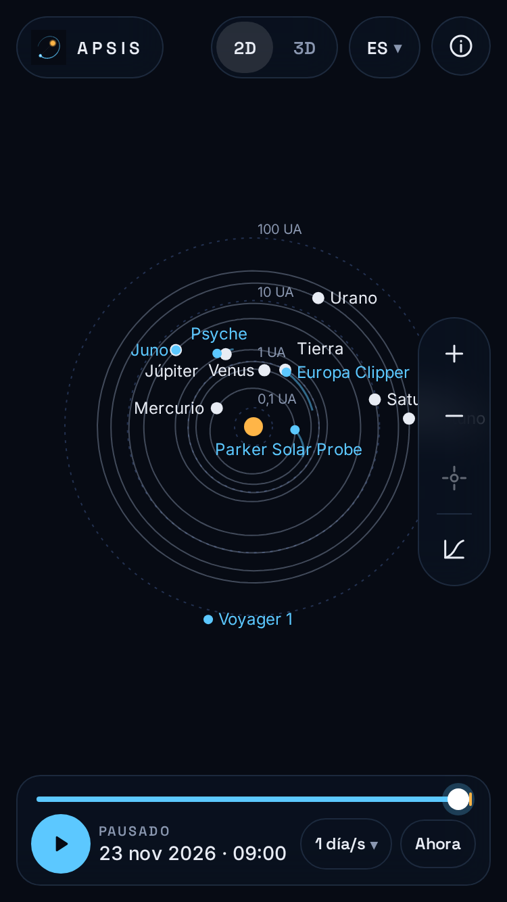
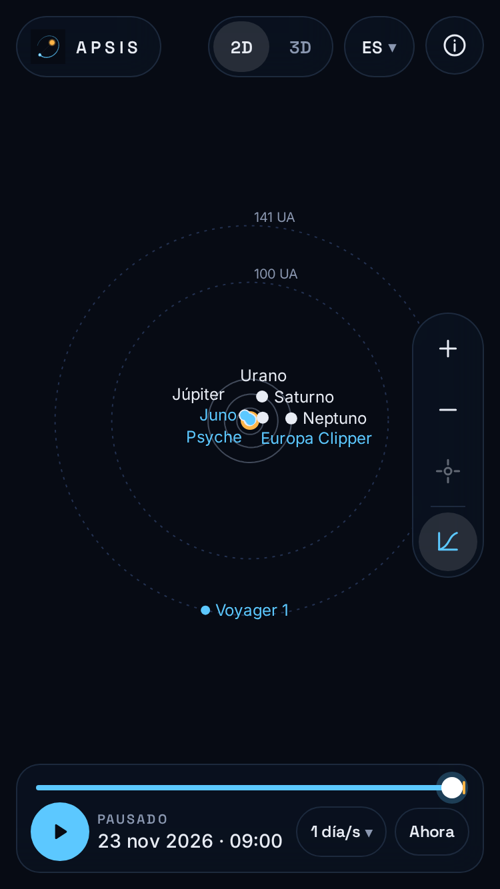
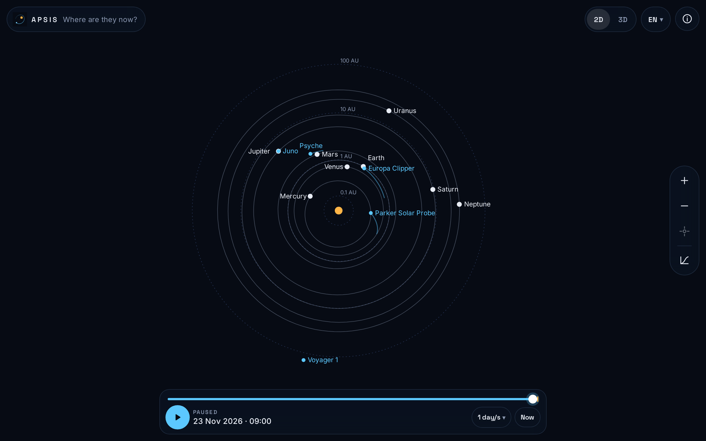
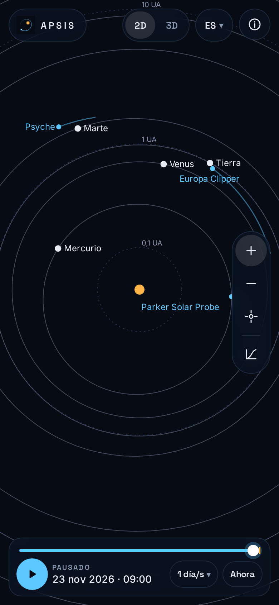
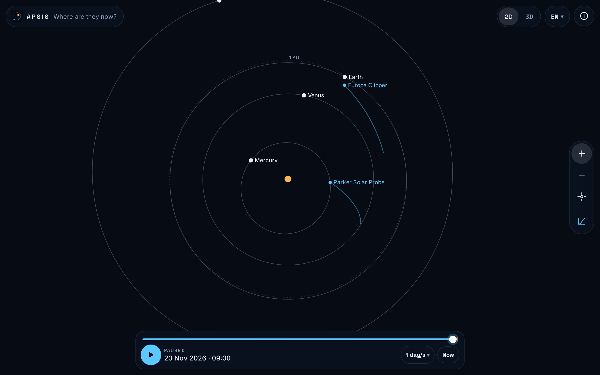

# The 2D map

The solar system seen from above the ecliptic's north pole: the Sun, the planets with
their orbits (see [orbits.md](orbits.md)) and the spacecraft at one instant, with each
spacecraft's last 30 days as a trail. The scale rings are dashed, so they don't read
as orbits. Code:
`src/map/` (projection, the view and its moves, the `<solar-map>` component), `src/core/labels.ts` (label
placement, shared with the 3D view), `src/core/trails.ts`, `src/data/load.ts`,
`src/main.ts`.

| Phone, log scale (Spanish)           | Phone, true distances                              |
| ------------------------------------ | -------------------------------------------------- |
|  |  |

All three at `?t=2026-11-23T12:00Z`.

## From data to the screen

1. `main.ts` loads everything `npm run data` wrote (`loadLiveData`): the index, the
   catalogue and every chunk. Two years of data, about 260 KB, so all at once.
2. `main.ts` sets the map's `time` from the time controller (now by default; see
   [time.md](time.md)): `?t=2026-12-03T16:15Z` in the address shows that instant,
   paused, and `?play=day` plays from there.
3. For each body, `<solar-map>` asks `stateFromChunks` for the state at `time`. A body
   without data at that instant isn't drawn; nothing is ever placed by guesswork. A
   body outside its own years (before launch, after its end) is simply absent; one
   that should have data that year but doesn't at that instant is listed as "no data
   for this date"; and with nothing at all to draw, the map says so.
4. `mapPoint` turns each position into a point on the map (below), labels are placed
   (`placeLabels`), and Lit renders the SVG.

## Looking from above

The map drops each position's height above the ecliptic and keeps its direction in the
plane: +x points to the vernal equinox, +y is 90° ahead along Earth's orbit, so the
planets go round anticlockwise. Most bodies sit close to the plane; Voyager 1 is 35°
above it, so its distance on the map (141 AU in the plane) is shorter than its real one
(172 AU). The mission card (M4) will show real distances.

## Two scales

On a true (linear) scale, with Voyager 1 at the edge, everything inside Uranus's orbit
collapses into the middle. The scale button in the tool column (`ui/view-tools.ts`,
shared with the 3D view; `main.ts` sets the map's `scale`) shows it on purpose: it shows
why the default is logarithmic. Zooming in (below) then shows the inner planets at
their true distances, and rings at 1, 10 and 100 AU appear once they're big enough to
read (`MIN_RING_PX`).

The log scale places a body at a radius proportional to `log10(1 + d / 0.1 AU)`:

- **Far out it's logarithmic:** each factor of 10 in distance gets about the same room
  (rings at 0.1, 1, 10 and 100 AU).
- **Near the Sun it turns linear,** thanks to the `1 +`: a plain logarithm would send
  anything closer than the innermost ring off to minus infinity, and Parker at
  perihelion (0.05 AU) would vanish into the Sun.
- **Directions never change,** only distances. The browser test that compares Earth's
  angle on the map with Horizons relies on that.

## Labels

Labels can't overlap each other, the markers, or the rings' own labels. `placeLabels`
goes through them in order of importance (spacecraft first, then planets) and tries
eight spots around each marker: right, left, above, below, then the diagonals. The
first free spot inside the visible area wins; with none free, the label hides.
Hovering or long-pressing any marker still names it (its SVG `<title>`). On a crowded
phone screen Mars may lose its label next to Psyche; the picker (M4) will name
everything.

The width of a label is estimated (6.6 px per character at 12 px), not measured:
measuring text in the DOM on every frame would cost more than an occasional loose fit.

## Layout

The map fills the screen and the controls float over it (ADR 0012). The disc is
centred in the room they leave, which `styles.css` gives as `--hud-top/right/bottom/left`
and a `ResizeObserver` reads with the map's size. SVG coordinates are CSS pixels from
the middle of that room, so text and markers keep their size on any screen.

## Moving around

| Phone, zoomed in on the inner planets         | Desktop, true distances, zoomed in                  |
| --------------------------------------------- | --------------------------------------------------- |
|  |  |

What shows is a `MapView` (`map/view.ts`, pure and unit-tested): a zoom, and the point
of the disc in the middle of the screen. Everything is drawn through `toScreen`, which
scales positions and leaves sizes alone: markers, labels and lines keep their size in
pixels while the distances between them grow.

- **Drag** (mouse or one finger) pans: `panBy` keeps what was under the pointer under it.
- **Wheel, trackpad pinch, two-finger pinch, double tap** zoom: `zoomAt` keeps the
  point under the pointer, or between the fingers, where it was. 300 px of wheel
  doubles the zoom (a trackpad pinch, which browsers send as a wheel with Ctrl, 100 px).
- **The tool column:** + and − zoom about the middle (`zoomBy`), and the "whole map"
  button goes back (`goHome`); it's disabled when there's nothing to go back to.
- **The keyboard,** with the map focused: arrows pan, + and − zoom, 0 goes back.

All of it is pointer events, one path for mouse, pen and touch; the SVG says
`touch-action: none`, so the page itself never scrolls or zooms under a gesture.
Zoom runs from the whole disc (1) to `MAX_ZOOM` (1000, enough for the inner planets on
true distances), and the middle can stray from the Sun by at most `1 − 1/zoom` of the
radius, so part of the map is always on screen. Changing the scale goes back to the
whole map: a close-up on one scale shows somewhere else on the other.

Close up, an orbit drawn from one epoch's elements would sit visibly off its planet
(planets drift up to 0.0004 AU from it, 14 px at full zoom on the log map), so the map
draws each orbit through its planet with `orbitPathThrough`, as the 3D view does
([orbits.md](orbits.md)).

## Offline

The service worker caches each data file the first time it's loaded, and from then on
answers from that cache at once while refreshing it in the background
(stale-while-revalidate, ADR 0007). So the map opens offline, showing the last data
fetched.
