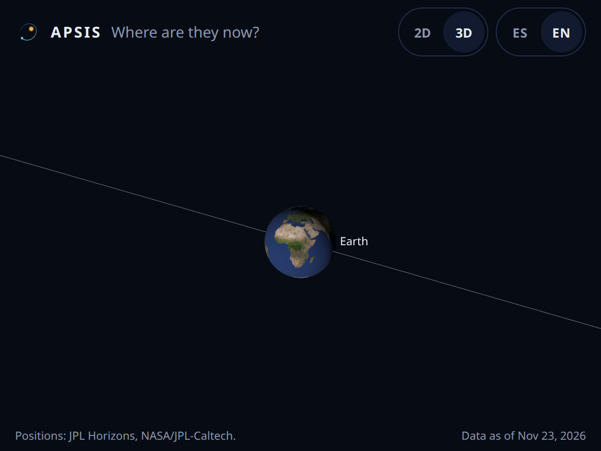
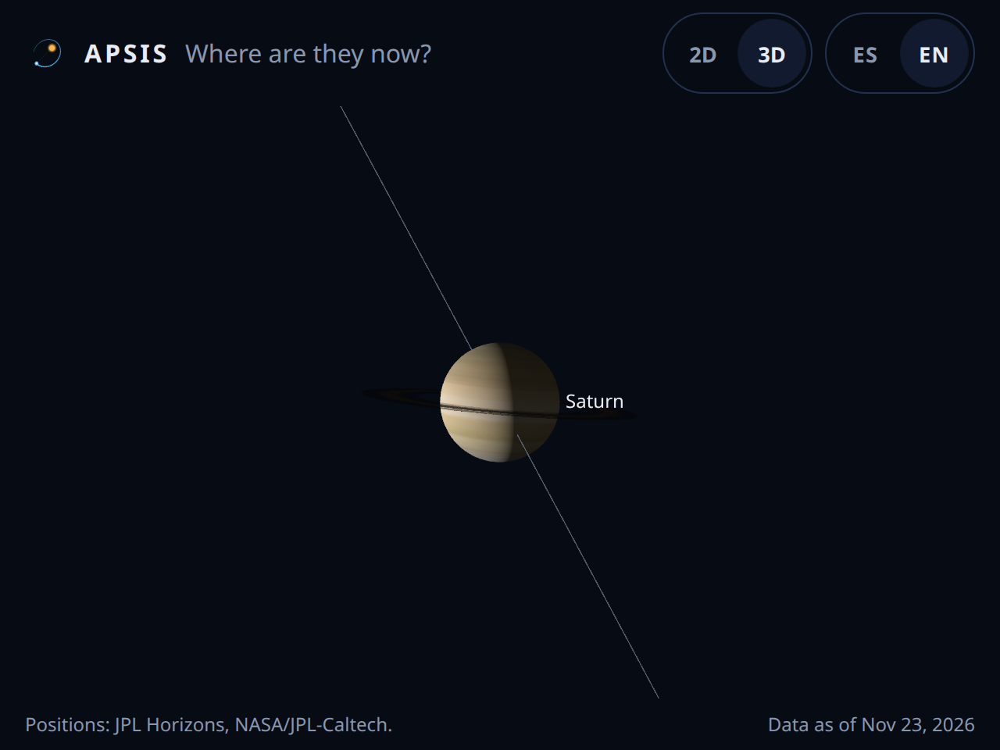

# Tilt and spin

How each planet in the 3D view is tilted and turned to how it really stands at the
shown instant, and how Saturn's rings follow. Code: `src/core/rotation.ts`,
`src/scene/sphere-basis.ts`, `#turn` and `#ringsFor` in `src/scene/solar-scene.ts`.

| Earth at 12:00 UTC: noon over Africa and Europe | Saturn, end of 2026: rings barely open |
| ----------------------------------------------- | -------------------------------------- |
|                     |          |

## The IAU rotation model

The IAU's Working Group on Cartographic Coordinates and Rotational Elements publishes,
for every major body, three things as functions of time (Archinal et al. 2018; the 2009
report for Mars):

- **α₀, δ₀:** the right ascension and declination of its north pole, in the ICRF
  equatorial frame, drifting slowly (per Julian century, T);
- **W:** the angle of its prime meridian (longitude 0), turning steadily (per day, d),
  measured along the body's equator from where that equator crosses the ICRF equator
  going north.

`ROTATION` holds those numbers for the Sun and the planets. The official models add
small periodic terms (under 0.7°, mostly for Mars and Neptune); we leave them out.

The IAU's "north" pole is the one on the north side of the solar system's plane,
whichever way the body spins. So Uranus's north pole sits 82° from ecliptic north (its
textbook 97.8° tilt measures the same axis by the right-hand rule), and Venus and
Uranus, which spin backwards, have a negative rate for W.

## From the model to axes

`bodyAxes(model, t)` builds three unit vectors:

1. **pole** from (α₀, δ₀): `(cos δ cos α, cos δ sin α, sin δ)`;
2. **node**, where the body's equator crosses the ICRF equator going north: 90° of
   right ascension past the pole's, `(−sin α, cos α, 0)`;
3. **meridian** = `cos W · node + sin W · (pole × node)`: W around the equator from the
   node; and **east** = `pole × meridian`.

All three are equatorial; our frame is ecliptic (ADR 0004), so each is turned about
the x axis (the vernal equinox, which both frames share) by the obliquity of the
ecliptic, 23.4392911°.

The test that ties it together uses a recorded Horizons position of Earth at 23:58:51
UTC on 29 December 2026: almost midnight at Greenwich, so the Sun must be overhead near
longitude 180°, at the Sun's December declination (about −23.2°). It is, to within a
degree, which checks the pole, the meridian and the frame conversion at once.

## Onto a three.js sphere

`SphereGeometry` wraps an equirectangular texture (longitude −180° at the left edge, 0°
in the middle) with longitude 0 along its local +x, 90° east along −z and the north
pole along +y. `sphereBasis` maps the body's axes onto those: x = meridian, y = pole,
z = −east, each through `toScene`. Those three vectors are the columns of the rotation
`#turn` gives the sphere. A test pins three.js's convention, and another checks that
x × y = z, so a texture can never come out mirrored.

Spheres turn when the shown time changes (every 10 s), like orbits and trails.

## Saturn's rings

A flat `RingGeometry` from the inner edge of the C ring to the outer edge of the A ring
(74,658 to 136,775 km), added as a child of Saturn's sphere: it lies in Saturn's
equatorial plane, tilts with it, and scales with it when the sphere is drawn larger
than life. Solar System Scope's ring texture is a strip that runs outwards, so each
vertex's texture coordinate is its distance from the centre, from 0 at the inner edge to
1 at the outer.

At the end of 2026 the rings look thin and dark, and that's right: Saturn passed its
equinox in 2025, so the rings are barely open, and the Sun now lights their south face
while the default camera looks from the north.
