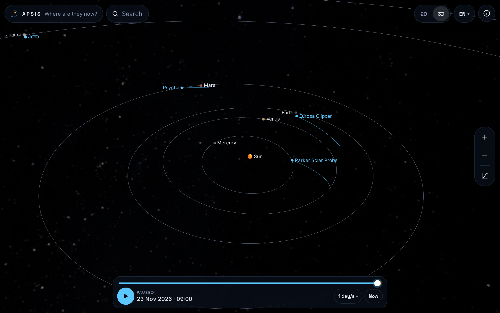
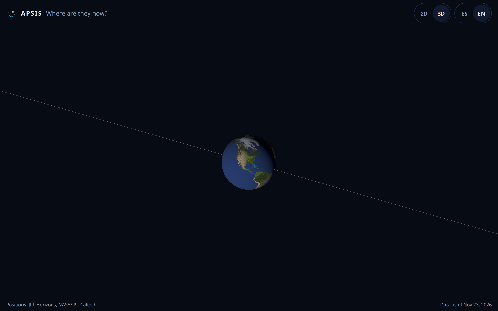
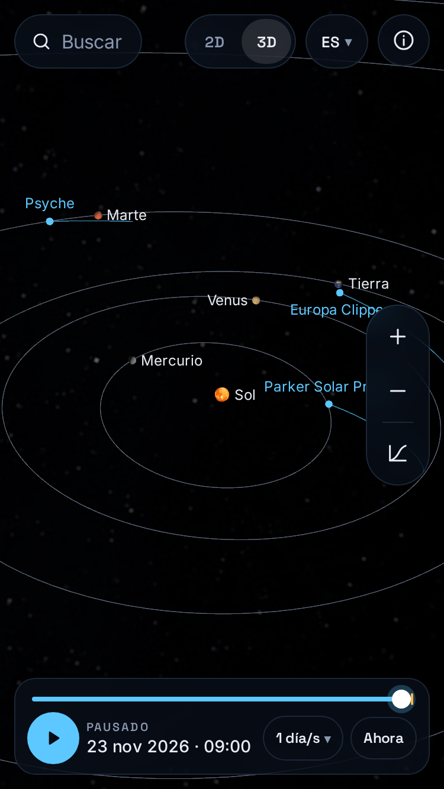

# The 3D view

The Sun, the planets and their orbits, and the spacecraft with their trails, in three
dimensions, at true scale with a minimum size on screen, every body named. Code: `src/scene/` (`solar-scene.ts`, `apparent-size.ts`, `label-layer.ts`),
`src/core/frames.ts` (axes), `src/core/math.ts` (vectors), `orbitPathThrough` in
`src/core/orbits.ts`, and the wiring in
`src/main.ts`. Decisions: ADR 0001 (renderer), 0004 (frames, floating origin), 0005
(scale).

| The inner solar system                         | Earth up close                           | On a phone                        |
| ---------------------------------------------- | ---------------------------------------- | --------------------------------- |
|  |  |  |

## Getting there

The 2D map is the default. The **2D / 3D** switch in the header (or `?view=3d` in the
address) shows the 3D view; `main.ts` imports `scene/solar-scene.ts` only then, so the
page itself stays small (13 KB gzipped) and three.js (about 230 KB gzipped) loads on
demand. If it can't start (an old device, a failed download), the map stays and a
short notice says why.

`SolarScene.create` makes a three.js `WebGPURenderer`, which uses WebGPU where the
browser has it and falls back to WebGL 2 by itself. The canvas says which in
`data-backend`. `?backend=webgl2` forces the fallback.

## Units and axes

Everything is in **kilometres**, from the data to the scene: no conversion to get
wrong (ADR 0004). The ecliptic frame has z towards ecliptic north; three.js has y up.
`toScene` maps `(x, y, z)` to `(x, z, −y)`, a rotation, so orbits keep turning the
same way; nothing else knows about the difference.

## The floating origin

The GPU stores positions as 32-bit floats: about 7 significant digits. Neptune is 4.5
billion km from the Sun, so a 32-bit position near it can only step by hundreds of km,
and anything near Neptune would jitter between those steps.

So the camera never looks at "the solar system": it looks at a **focus** (the Sun by
default; whatever is selected, see [selection.md](selection.md)). Every frame, `#frame()` works out
each body's position in 64-bit JavaScript numbers, subtracts the focus's position
(`subtract` from `core/math.ts`), and only then hands the result to three.js. Near the focus the numbers
are small and precise; far away they're large and imprecise, but far away is also tiny
on screen. `frames.test.ts` shows the difference: over a km lost near Neptune with
absolute positions, under a centimetre with relative ones. The camera orbits the focus
at the origin, which is why panning is off: a drag turns, the wheel or a pinch zooms
(three.js's `OrbitControls`), and the tool column's + and − call `zoomBy`, which moves
the camera within the same limits.

## True scale with a minimum size

Bodies are spheres of their true radius (`core/bodies.ts`), scaled up only when that
would make them smaller than 7 px across on screen (12 px for the Sun):

```text
units per pixel at distance d = 2 · d · tan(fov / 2) / viewport height
drawn radius = max(true radius, 3.5 px × units per pixel)
```

`displayRadius` does this per body, per frame, from the camera's distance. From 3 AU
away, on a screen 800 px tall, one pixel spans about 465,000 km, so Earth is drawn
about 250 times its size; up close it's drawn at its true size.
That's the "minimum on-screen size" of ADR 0005; the scale switch (below) turns it off.

## Orbits that pass through their planets

Drawing an orbit as evenly spaced points works from afar but fails up close, for two
reasons:

- **Chords.** 360 points around Neptune's orbit are 78 million km apart; a straight
  segment between two of them strays up to about 170,000 km from the curve, seven
  Neptune radii.
- **Drift.** A planet wanders up to about 0.0004 AU (60,000 km) from one epoch's
  osculating ellipse (ADR 0010).

`orbitPathThrough(elements, count, position)` solves both: it starts and ends the loop
at the planet, packs points densely there (from about 100 km apart at Mars to 2,400 km
at Neptune: well inside the planet either way) and sparsely on the far side, and shifts the whole ellipse by the planet's drift, so it passes exactly
through the planet. The shift is invisible at solar-system scale. The scene recomputes
orbit lines only when the time or the focus changes, never per frame.

## Spacecraft and trails

Spacecraft are a few metres across, so they're always drawn at their minimum: a 6 px
dot in the spacecraft colour (`--color-craft`), unlit. Behind each one, its last 30
days (`trailPoints` in `core/trails.ts`, the same function the 2D map uses), drawn as a
line relative to the focus and recomputed only when the time or the focus changes,
like the orbits.

Up close the trails show their limits: with one sample a day, Juno's trail around
Jupiter is a jagged polygon, and Juno itself whips out of a close-up frame. That's the
interpolation finding of step 1.3; Jupiter-centred data minutes apart comes with the
local views (M5).

## Labels

Names are HTML, not drawn into the scene: crisp at any size, in the visitor's
language, and nothing to rebuild when it changes. `LabelLayer` keeps one `<span>` per
body over the canvas. Every frame, `#placeLabels` projects each visible body to the
screen (three.js's `Vector3.project`, which gives -1…1 coordinates, turned into CSS
px), works out its radius in px, and hands the list to `placeLabels` in
`core/labels.ts`: the same algorithm the 2D map uses, spacecraft first. A label with
no free spot hides; a label whose position hasn't changed isn't touched.

Planet names come from `i18n/bodies.ts` (shared with the map), mission names from the
catalogue; `main.ts` renames them after a language switch (`setNames`).

## Tilt, spin and rings

Each planet (and the Sun) is tilted and turned to how it stands at the shown instant,
from the IAU rotation models, and Saturn's rings lie in its equatorial plane. See
[rotation.md](rotation.md).

## The sky

Behind everything, Solar System Scope's Milky Way texture on a sphere seen from inside
(`#skyFor`). It follows the camera, so it always looks infinitely far away, is drawn
first without touching the depth buffer, and is dimmed (`SKY_BRIGHTNESS`) so names and
orbits stay readable.

The texture is in galactic coordinates: the Milky Way runs along its middle row and the
galactic centre is its brightest spot, at its centre. `galacticAxes` (in
`core/frames.ts`) gives the real directions of the galactic centre (in Sagittarius,
5.6° south of the ecliptic) and of the galactic pole (the plane is tilted 60° to the
ecliptic), and the sky sphere is turned to match. That's as far as it goes: no known
bright star (Sirius, Canopus, Vega…) shows up where it should in either orientation of
the image, so it's artwork, not a star catalogue, and the guide says so.

## Scale

The note and button at the bottom (`ui/scale-switch.ts`, shared with the map) switch
the 3D view between planets enlarged to their minimum on-screen size and true sizes,
where they shrink below a pixel and only their names show where they are. Spacecraft
keep their markers either way. Each view remembers its own setting.

## Light and depth

A point light at the Sun lights the planets (no fall-off with distance: at these
scales physical fall-off would leave Neptune black), with a faint ambient light so
night sides don't vanish. The Sun itself is unlit (it _is_ the light). The renderer uses
a **logarithmic depth buffer**, which keeps depth precise from a kilometre to a
thousand AU on both backends.

## Testing it

`tests/e2e/scene.spec.ts` runs on four Playwright projects:

| Project   | Browser                                | Backend it must get             |
| --------- | -------------------------------------- | ------------------------------- |
| `phone`   | Chromium, Pixel 7                      | WebGL 2 (forced)                |
| `desktop` | Chromium                               | WebGL 2 (forced)                |
| `iphone`  | WebKit, iPhone 13                      | WebGL 2 (WebKit's own fallback) |
| `webgpu`  | Chromium's newer headless, SwiftShader | WebGPU                          |

The default headless Chromium offers WebGPU but can't show its frames, so `phone` and
`desktop` force the fallback, as gravitas does. The `webgpu` project uses the newer
headless Chromium with a software GPU, which can. The tests check the backend, count
Sun-coloured pixels in the middle, find Neptune up close, switch views, and check the
fallback when the 3D code can't load. A software GPU says nothing about speed on a
real phone; that needs a device.
