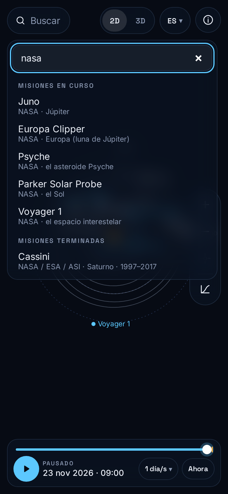
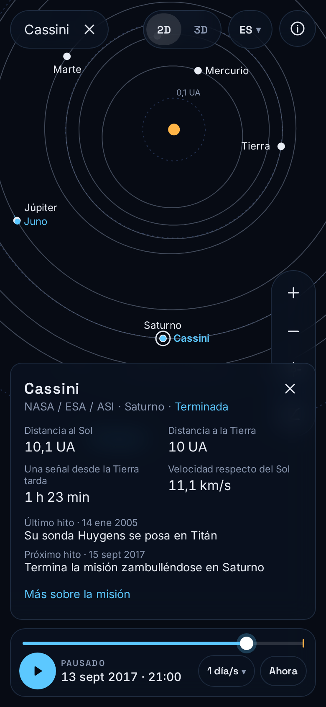
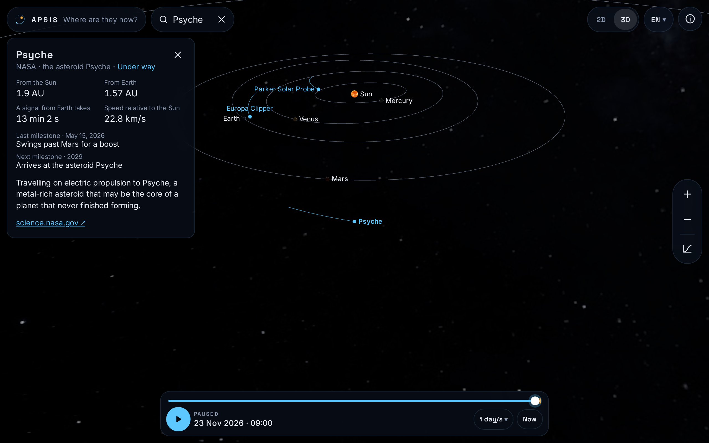
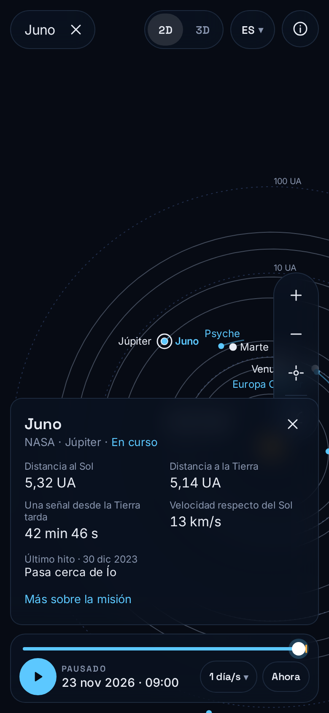
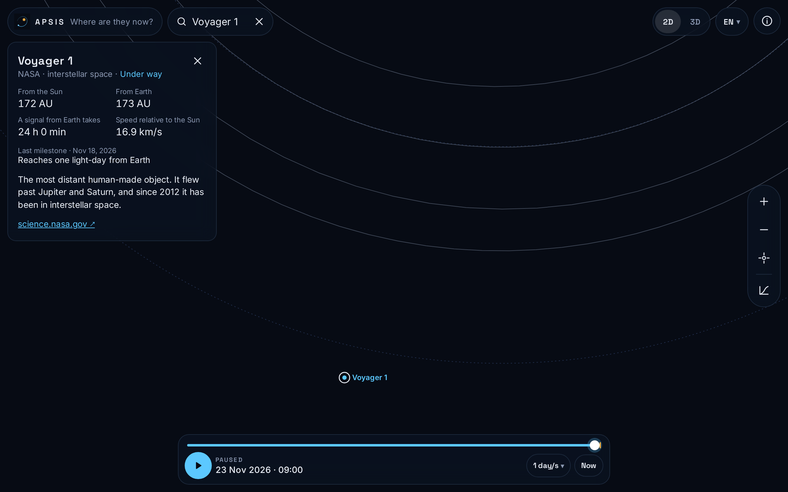

# Picking and selection

One body at a time can be **selected**: a mission, a planet or the Sun. The map rings it
and names it first, the 3D camera flies to it and orbits it, and the address says so
(`?focus=juno`), so a link opens on it. Its card says where it is and what it's for.

| The list, on a phone              | Cassini, picked in 2026                  | Psyche in 3D                         |
| --------------------------------- | ---------------------------------------- | ------------------------------------ |
|  |  |  |

## The card

| Juno, on a phone               | Voyager 1, on a desktop               |
| ------------------------------ | ------------------------------------- |
|  |  |

`ui/mission-card.ts` shows the selection at the displayed instant, so as time plays
the numbers move:

- **Distance from the Sun and from Earth,** in AU with three significant digits, or in
  km below 0.01 AU (`formatDistance`).
- **How long a signal from Earth takes** (light-time, `lightTimeSeconds`): "24 h 0 min"
  for Voyager 1 on 23 November 2026, a light-day away since the 18th.
- **Speed relative to the Sun** (heliocentric, as Horizons gives it).
- For a mission: the agency, the target and whether it's under way; the **last and
  next milestones** around the displayed instant (`milestonesAround`, which reads a
  loose date like "2029" from its start); the blurb and the links.

The numbers come from `factsAt` (`core/facts.ts`, pure): the body's state and Earth's,
both interpolated at the same instant. The Sun's card has only the distance from Earth
and the signal time; Earth's leaves out the distance to itself. With no position at
the displayed instant, the card says so instead of guessing.

`main.ts` builds the card (`showCard`) whenever the time, the selection, the language or
the loaded years change; the component only formats. On a desktop it sits top left, all
of it showing; on a phone it sits above the time dock, short, with the blurb and links
behind "Más sobre la misión". Its × clears the selection.

## Where selection lives

`main.ts` holds it (`selected`) and is the only place that changes it, in `select()`:

1. **A mission picked at an instant it has no positions for** (Cassini today, Juno
   before 2011) first takes time to the nearest instant it has: `instantWithData` in
   `core/catalogue.ts` (pure, tested) clamps to the mission's coverage, a day clear of
   its ends. Time pauses there, as after a seek.
2. It hands the id to every view: `map.selected`, `scene.select(id)`, and the picker
   through the shell (`app.selected`).
3. It moves the views to it, unless the selection came from a tap on the map:
   `map.centreOnSelection()` and the 3D flight. A tap selects in place: jumping away
   from under your finger would be jarring. At start-up (`?focus=` in the address) the
   camera is simply there, without a flight.
4. The address follows (`history.replaceState`, as the time does).

Every way of selecting ends in a `body-select` event (detail: an id, or `null` to clear)
or, from the 3D view, the scene's `onPick` callback. Both lead to `select()`.

## The picker

`ui/body-picker.ts`: a pill in the top row ("Buscar", or the selection's name with a ×
to clear it) that opens a list in a **popover** (`popover` attribute): the browser puts
it above everything, closes it on Escape or a tap outside, and hands focus back to the
pill, with no code of ours. The list is built by `pickerEntries` from the catalogue:
missions under way, ended ones with their years, then the Sun and the planets.

Typing filters by name, agency and target (`ui/search.ts`, `matches`): every word of the
search must appear, accents and case aside, so "jupi" finds Júpiter, and Juno and
Europa Clipper too (they're going there). Enter takes the first entry whose _name_
matches, ahead of those that only mention it.

On phones the top row has no room for the name "APSIS" and the picker together: the
picker wins and the name stays for screen readers only (it's on the home-screen icon
and in the info panel). Once something is selected, the pill on a phone shows just its
name and the ×.

## Tapping a body

Markers are a few pixels across; fingers are about 44. `pickAt` (`core/pick.ts`, pure,
shared by both views) takes every body's position and drawn radius on screen and
returns the nearest whose edge is within `PICK_REACH_PX` (22 px) of the tap.

- **The map** remembers where it drew each body (`#marks`) and picks on a tap: a press
  that moved less than `TAP_SLOP_PX`. A double tap still zooms (it selects, too).
- **The 3D view** keeps each frame's screen positions (the same list its labels are
  placed from) and picks on a press that stayed put; a drag still turns the camera
  (OrbitControls).

## On the map

The selection gets a ring and a bold label, placed before every other label so it's
never the one hidden. `centreOnSelection` brings it to the middle with `centredOn`
(`map/view.ts`), which zooms in only as far as that needs: at the whole map, the
middle can't leave the Sun, so picking Saturn zooms until Saturn can be in the middle.
It zooms in by itself at most to `CENTRING_ZOOM` (4): Voyager, near the edge, would
need 20, all of it empty space, so it stops there, as near the middle as that allows.
If the selection has no position yet (its year is still loading), centring waits for
it.

## In 3D: the flight

`scene.select(id)` changes the focus (what the camera orbits, the floating origin;
see [scene.md](scene.md)) and starts a flight of `FLIGHT_MS` (1.2 s), or none for
those who prefer reduced motion. Each frame of the flight (`#fly`):

- **The origin** moves from where it was towards the new focus, easing in and out
  (smoothstep), so everything glides rather than jumps.
- **The distance** changes by equal factors (interpolated on a log scale): from 3 AU
  to Neptune's 12 radii is a factor of 1,700, and a straight line would rush through
  the close part.
- **The direction** stays for a planet or the Sun. A spacecraft has no size to frame,
  so the camera stands outside it, at 1.5 times its distance from the Sun, tilted 32°
  above the ecliptic and looking in: the neighbourhood ADR 0005 asks for, the inner
  planets behind Psyche, the outer system behind Voyager.

When the flight ends, the camera keeps orbiting the focus as before. Orbit lines and
trails are redrawn whenever the origin moves, so they're right during the flight too.
