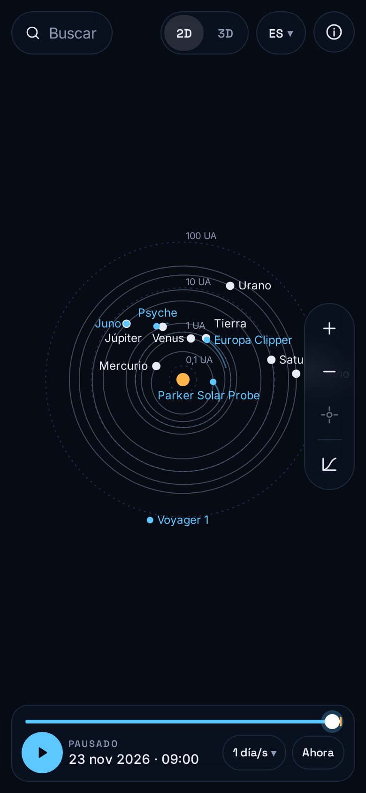
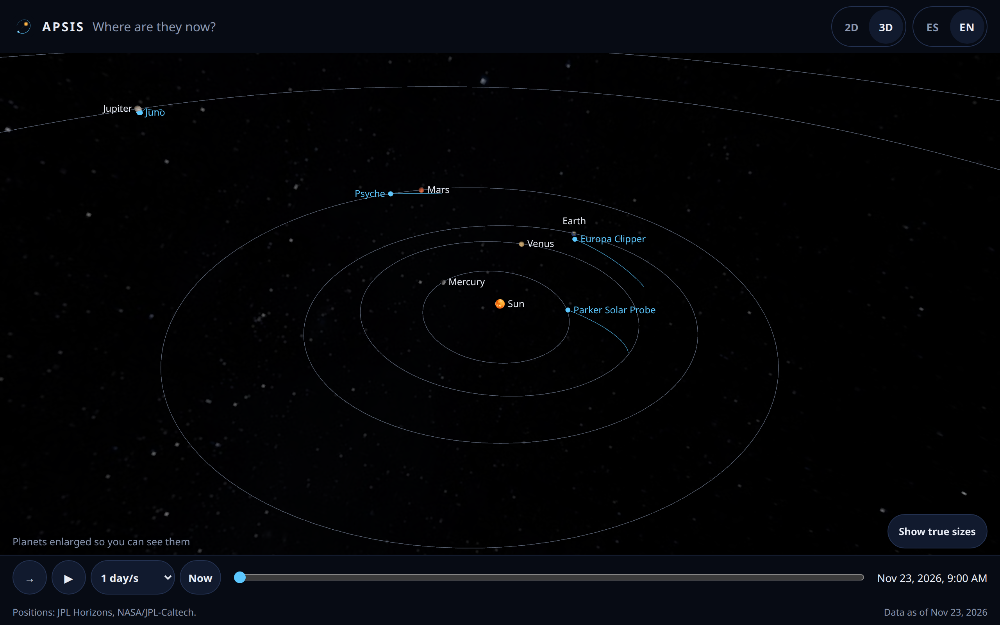

# Time

How the displayed instant is chosen and how it moves: now, a moment from a link, or
playing forwards and backwards. Code: `src/core/playback.ts` (pure),
`src/time/controller.ts` (the clock), `src/ui/time-slider.ts` (the time bar),
`src/main.ts` (the wiring). Decision: ADR 0011.

| The time bar on a phone            | On a desktop, in 3D                    |
| ---------------------------------- | -------------------------------------- |
|  |  |

## One owner

Every view takes the instant as an input (`time` on the map and the scene, in TDB
seconds); none of them reads the clock. One `TimeController`, created in `main.ts`,
owns the instant and how it moves, and calls back on every change. `main.ts` converts to
TDB (`tdbSecondsFromUtcMs`) and hands the result to both views.

## Playback, pure

`Playback` is three numbers' worth of state:

- `instantMs`: the instant shown, UTC ms since 1970, as the clock counts;
- `rate`: simulated seconds per real second: `0` paused, `1` real time, `86 400` a day
  per second (`SPEEDS`: real time, day, week, month), negative backwards;
- `live`: whether it follows the clock ("now").

`advance(playback, elapsedMs, nowMs, range)` moves it on by some real time: live, it's
just the clock's reading; playing, the instant moves by `rate × elapsed`, and when it
reaches the edge of the data it **pauses there** instead of running into dates with
nothing to show. A paused instant, or one asked for in a link, is left alone even
outside the data (`?t=1990-01-01` shows "no data for this date").

## The clock, at the edge

`TimeController` drives `advance` with the real clock, as cheaply as each state allows:

| State         | Ticks                                  |
| ------------- | -------------------------------------- |
| Following now | once a second (spacecraft barely move) |
| Playing       | every frame (`requestAnimationFrame`)  |
| Paused        | not at all                             |

`play(rate)`, `pause()`, `seek(instant)` and `goLive()` are what the time bar calls.
`range` is set once the index is known: from 1 January of the first year with data
(archived or live) to the end of the live window (two minutes early, clear of the last
sample whatever the TDB/UTC offset). Years load as the instant needs them (see
[data.md](data.md)).

## The address bar

While the instant isn't "now", `?t=2026-12-03T16:15Z` in the address follows it (at
most twice a second while playing, minute precision), so any moment can be shared or
reloaded; following now, `t` disappears. `?play=day` (or `week`, `month`; `-day`
backwards) starts playing from the link.

## The time bar

`<time-slider>` sits between the view and the footer: one row on a desktop; on a
phone, the buttons on one row and the slider and date below. It shows and emits, and
owns nothing but its own choice of speed and direction; `main.ts` turns its intents
into controller calls.

- **Direction** (→ / ←) and **play / pause** (▶ / ❚❚): play uses the chosen speed and
  direction; changing either while playing takes effect at once.
- **Speed**, a native `<select>`: real time, 1 day, 1 week or 1 month per second.
- **Ahora / Now**, pressed while following the clock.
- **The slider**, a native `<input type="range">` over the span with data, a minute
  per step: keyboard and screen readers work out of the box. Dragging pauses at the
  dragged instant.
- **The date and time**, in the visitor's language and time zone (`Intl`).

The controls are disabled until the data (and so its span) has arrived.
