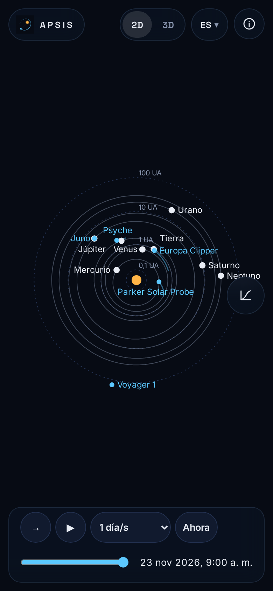
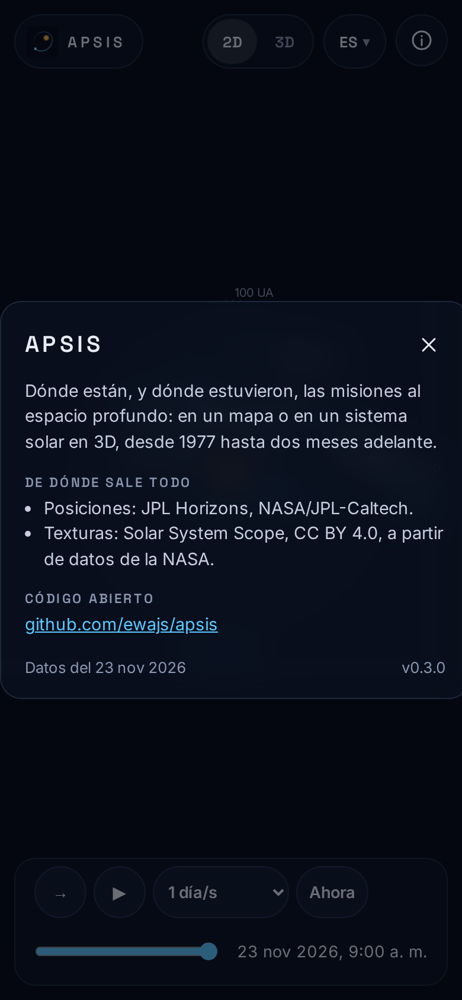
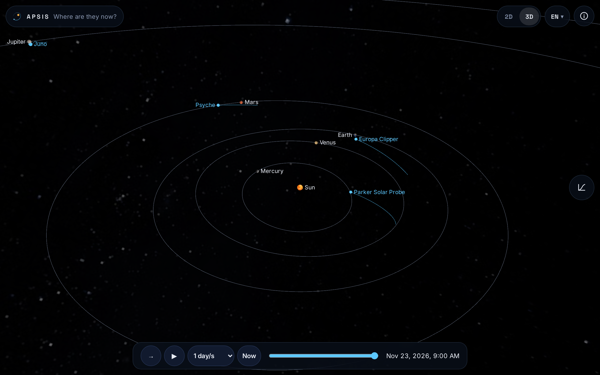

# The UI shell: Lit, two languages and the installable app

How the page starts, how components get their text in two languages, and how the app
installs and works offline. Code: `src/main.ts`, `src/ui/`, `src/i18n/`,
`vite.config.ts`, `scripts/icons.ts`.

## The frame

| Phone, map                | The info panel          | Desktop, 3D                   |
| ------------------------- | ----------------------- | ----------------------------- |
|  |  |  |

The look is "Glass" (ADR 0012, after gravitas): the view (map or 3D) fills the screen
and every control floats over it.

- `apsis-app` lays them out: the name top left; `view-switch`, `language-switch` and the
  info button top right; a notice (`role="status"`) under them; `view-tools` (the tool
  column) on the right edge; the time dock at the bottom; `info-panel` (a native modal
  `<dialog>`: credits, data date, version) on demand.
- Shared styles are in `ui/glass.ts` (`.glass` panels, `.pill`s, `.icon-button`s), icons
  in `ui/icons.ts`; colours, fonts and the glass come from tokens in `styles.css`, with
  solid panels under `prefers-reduced-transparency`.
- `--hud-top/right/bottom/left` say how much room the floating controls take at each
  edge; the 2D map reads them and centres itself in what's left (narrow screens let the
  tool column float over the map's edge; short ones let the map run up between the top
  pills).
- Inter and Space Grotesk are self-hosted (`@fontsource-variable/*`, imported in
  `main.ts`); only the Latin files are precached.

## Start-up

`index.html` holds no content, only a `<noscript>` line and the module script.
`src/main.ts` then:

1. loads `src/ui/styles.css` (design tokens and page-wide styles);
2. picks the language: a choice saved in `localStorage` wins, otherwise Spanish for
   any Spanish browser language and English for the rest (`pickLocale`, tested);
3. loads that language's text (`setLocale`), sets `<html lang>`, and puts
   `<apsis-app>` in the page.

Storage and `navigator.languages` are touched only in `main.ts`; `pickLocale` takes
them as arguments, so it stays a plain function with unit tests.

## Lit components

A Lit component is a standard custom element: a class that extends `LitElement`,
registered under a tag name (`@customElement('apsis-app')`). Three ideas carry most of
the weight:

- **Reactive properties.** `@property() locale` declares a property that re-renders the
  component when it changes. `main.ts` sets `app.locale = 'en'` and Lit does the rest.
- **`render()` returns a template**, written with the `html` tag. Lit remembers which
  parts are dynamic (`${…}`) and updates only those. `.locale=${…}` sets a property
  on a child, `@click=${…}` adds a listener, and plain `attr=${…}` sets an attribute.
- **Shadow DOM.** Each component's markup and `static styles` live in their own shadow
  root, so its CSS can't leak out and the page's CSS can't leak in. The exception is
  CSS custom properties: `var(--color-text)` inside a component reads the token set on
  `:root` in `styles.css`. That is how one set of tokens styles every component.

Data goes down as properties and comes up as events: `<language-switch>` doesn't
change the language. It fires `locale-change`, which bubbles out of the shadow roots
(`composed: true`) to `main.ts`, which switches the language, saves the choice and
sets `locale` back down. One owner for each piece of state.

The decorators (`@customElement`, `@property`) are TypeScript's older
"experimental" decorators, as in gravitas; `tsconfig.json` turns them on, together
with `useDefineForClassFields: false` so class fields don't hide Lit's accessors.

## Two languages

Player-facing text is written in Spanish inside `msg()`, each with a stable id:

```ts
msg('¿Dónde están ahora?', { id: 'tagline' });
```

`src/i18n/locales/en.ts` maps every id to its English text. `@lit/localize` runs in
_runtime_ mode: switching languages loads `en.ts` (a separate small chunk) and
re-renders every component that called `updateWhenLocaleChanges(this)` in its
constructor. No reload, and no state lost.

`tests/i18n.test.ts` reads every `msg()` id in `src/` and fails if English is missing
one, has one that no longer exists, or has an empty text. To add a string: write it in
Spanish with a new id, then add the id to `en.ts`.

Language names in the switch (`Español`, `English`) are not translated on purpose:
each is shown in its own language, so a visitor finds theirs whatever is showing.

## Installable and offline

`vite-plugin-pwa` writes three things into the build:

- `manifest.webmanifest`: name, colours and icons, which make the app installable;
- `sw.js`: a service worker that precaches the app shell (HTML, JS, CSS, icons);
- `registerSW.js`: registers it.

The service worker answers the shell's requests from its cache, so the app opens
offline after the first visit. With `registerType: 'autoUpdate'`, a new deployment
installs in the background and takes over on the next launch (ADR 0007). Data will
be cached separately, at runtime, so the daily data refresh doesn't count as an
update.

The browser tests check both: the manifest and its icons load, and the app opens with
the network off.

## The icon

`scripts/icons.ts` draws the icon from a few numbers (orbit size, eccentricity, trail
length and fade) and the colours in `styles.css`, then renders the PNG sizes with
Playwright's Chromium. Run `npm run icons` after changing any of them; the outputs in
`public/` are committed. The favicon is a separate, simpler drawing, because the
fine lines of the full icon disappear at 16 px.
